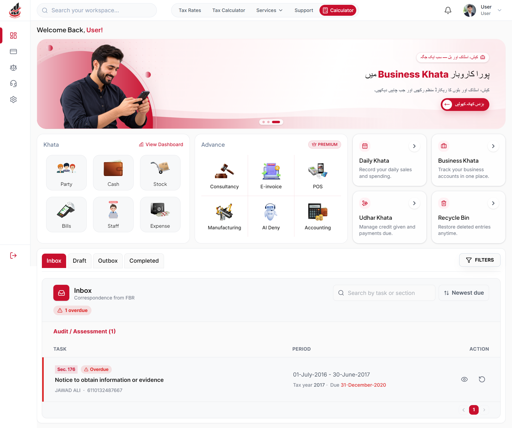
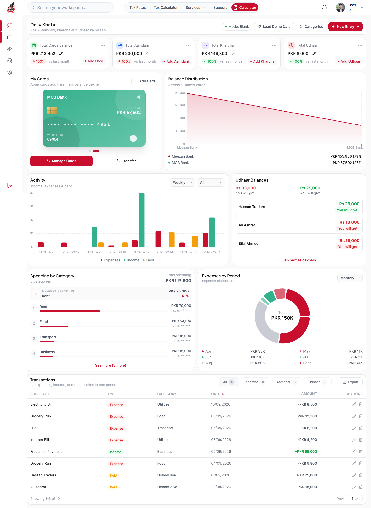

# 🚀 FilerNow Dashboard – Personal Finance & Tax Workspace

<p align="center">

  

  

  

  

  

  

  

</p>

## 📌 Overview

The FilerNow Dashboard is the logged-in product side of FilerNow, built as a separate Next.js app from the public website.

It gives individual users one place to track expenses, understand spending trends, and keep an eye on debts. It is designed around a personal user, not an enterprise team.

<p align="center">

  

</p>

## 🎯 Problem

- ❌ Personal finance tools that feel like corporate SaaS (approvals, teams, employees)

- ❌ Spending data with no clear trend or category picture

- ❌ Inconsistent UI when each page invents its own styles

- ❌ Dashboards built page-by-page with no shared design foundation

## 💡 Solution

- ✅ Token-based design system built before the first feature

- ✅ Expense Manager with derived stats, trends, and category breakdown

- ✅ Logic isolated in a dedicated store hook, not scattered across components

- ✅ Minimal, consistent UI language for a personal-user product

## ⚡ Key Features

- 💸 Expense Manager: add, edit, and categorize expenses

- 🗂️ Category manager dialog

- 📋 Sortable and filterable expenses table

- 📈 Trend chart (six months of seeded data)

- 🥧 Category breakdown

- 🧾 Debt summary card

- 💾 localStorage persistence with derived stats

- 🎨 Shared CSS token architecture across the whole dashboard

## 🛠 Tech Stack

- ⚛️ Next.js (App Router) + React

- 🟦 TypeScript

- 🎨 Tailwind CSS with a custom token layer

- 🧩 Radix UI / shadcn primitives

- 📋 React Hook Form + Zod

- 📊 Recharts

- 🎯 Lucide React

## 🧠 Engineering Decisions

- **Tokens first:** the CSS is split into `globals.css`, `theme.css`, `base.css`, `utilities.css`, and `components.css`, so no page ever hardcodes a color.

- **One store hook for the module:** `useExpenseManagerStore` owns persistence and derived stats (totals, trends, breakdowns). Components just render.

- **Derived, not stored:** stats are computed from the expense list, never kept as a second copy that can drift.

- **Per-repo token discipline:** design tokens are scoped to each repo, so conventions from the public site are verified before they're reused here.

- **Honest data layer:** dummy data is clearly seeded and isolated, ready to swap for real API calls.

## 📈 Results / Impact

- 🚀 A reusable design foundation for every future dashboard module

- 📊 Full expense workflow: add, categorize, sort, filter, visualize

- 🧱 UI logic separated from state logic

- 🎯 Ready for backend integration without a UI rewrite

## 📸 Project Preview

### 🖥️ Dashboard


### 📱 Khata



## 📂 Folder Structure

```text
app/
components/
├── expense-manager/
├── ui/
hooks/
data/
lib/
styles/
├── globals.css
├── theme.css
├── base.css
├── utilities.css
└── components.css
```

## ⚙️ Installation

```bash
git clone https://github.com/aliiashraf777/filernowfull-dashboard.git

cd filernowfull-dashboard

npm install

npm run dev
```

## 🔗 Live Demo

[LIVE_URL](https://filernowfull-dashboard.vercel.app/user-dashboard)

## 💻 Repository

[https://github.com/aliiashraf777/YOUR-DASHBOARD-REPO](https://github.com/aliiashraf777/filernowfull-dashboard)

## 🚀 Future Improvements

- Replace seeded data with real API calls

- Digital Khata module (daily, business, udhaar, party)

- Authentication-gated routes

- Export and reporting

## 🧠 What I Learned

- Building a design system before building features

- Separating state logic from presentation

- Scoping design tokens per repo

- Designing for a personal user, not a corporate one

## ⭐ Support

Give it a star if you like it ⭐
